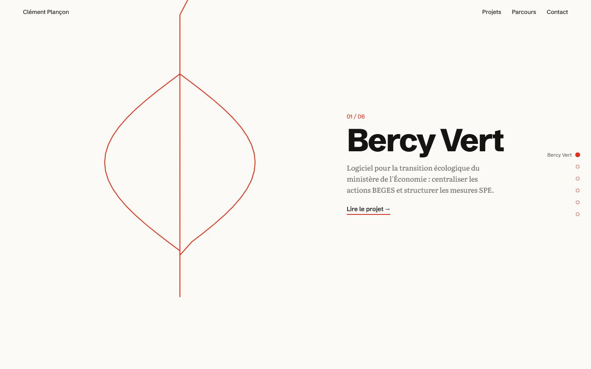
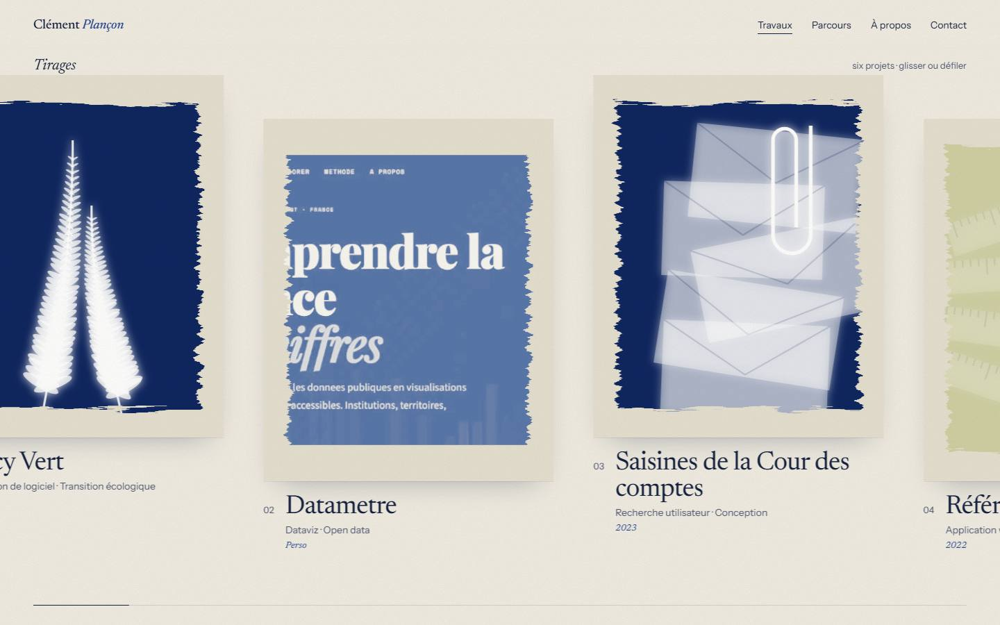
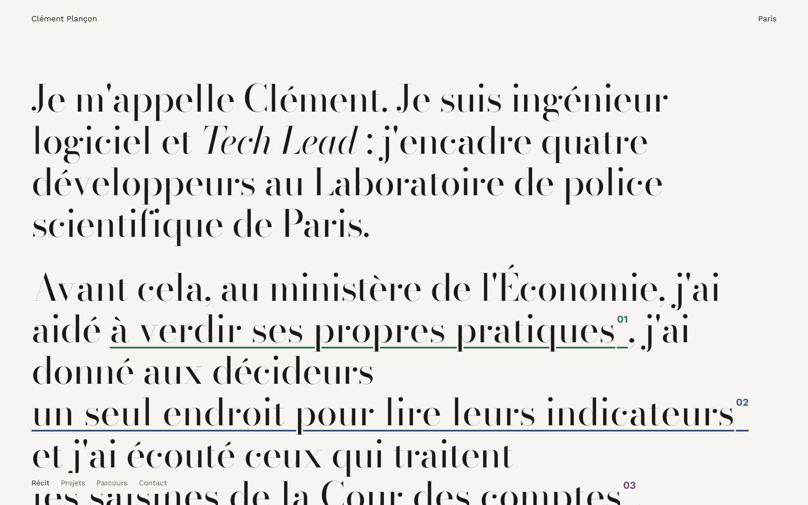

# Direction artistique : « Révélateur »

## Pourquoi on repart de zéro

La direction précédente, « Départs », empruntait sa grammaire à la signalétique d'information voyageurs : panneaux noirs, jaune signal, tableau à palettes, monospace. Elle était cohérente, mais elle produisait une **interface**, pas un portfolio : on lisait un tableau de bord industriel, les projets étaient des lignes de tableau avec des sigles (BV, RI…), rien ne donnait envie de cliquer.

Ce qu'on garde : le contenu réel, l'administration, l'infrastructure, le référencement, les tests. Ce qu'on jette : tout le langage visuel (panneaux, sigles, palettes, Overpass, jaune), sans chercher à le sauver.

## Trois concepts prototypés

Chaque prototype est une page HTML navigable avec le vrai contenu : introduction, plusieurs projets réels, interaction principale, navigation, version mobile (`docs/prototypes/v2/`). Tous ont été ouverts dans Chromium et capturés en 1440 et 390 px, puis corrigés une fois avant comparaison.

### A — « Le fil rouge »
Un seul fil rouge court sur toute la page. Il part emmêlé autour du titre « Démêler le complexe. », se tend au défilement et trace, d'un seul trait, une figure par projet (feuille, enveloppe, jauge, loupe). Une mini-carte du fil sert de navigation.

### B — « Révélateur »
Le cyanotype : le procédé photographique de 1842 qui a donné le *blueprint* des ingénieurs. Chaque projet est un **tirage** : un photogramme (des objets posés sur le papier sensible) ou la vraie capture tirée en bleu de Prusse. Les tirages se développent sous les yeux du visiteur, passant du jaune-vert du papier sensibilisé au bleu. Galerie horizontale pilotée par le défilement.

### C — « Le récit »
La page d'accueil est une phrase en très grand corps (« J'ai aidé le ministère à *verdir ses propres pratiques*… »). Les passages soulignés se déplient en fiches de projet au milieu du texte.

## Évaluation

Notes de 1 à 5, après manipulation des prototypes dans le navigateur et revue des captures desktop et mobile.

| Critère | A Fil rouge | B Révélateur | C Récit |
|---|---|---|---|
| Qualité artistique | 3 — les figures au trait ressemblent à des icônes | 5 — matière, couleur, images riches | 4 — très belle typographie, registre « magazine de mode » |
| Originalité | 3 — le tracé SVG au défilement est un effet courant | 5 — aucune référence étudiée n'utilise le cyanotype | 4 — le *stretchtext* est rare |
| Mémorisation | 3 | 5 | 4 |
| Cohérence | 4 | 5 — le même traitement unifie captures réelles et visuels | 3 — les fiches dépliées sont des blocs de couleur sans lien avec le texte |
| Ergonomie | 4 | 4 — défilement horizontal à maîtriser | 2 — les projets sont cachés derrière des phrases |
| Pertinence pour le profil | 4 — démêler | 5 — rendre visible, blueprint, laboratoire, sans cliché | 4 — voix personnelle |
| Faisabilité | 4 | 4 — génération au build | 3 — un `<button>` dans le texte casse la ligne dans Chromium |
| Performance | 5 | 4 — filtres SVG à surveiller | 5 |
| Mobile | 4 | 4 — balayage horizontal natif | 3 |

**Choix : B, « Révélateur ».**

- C'est la seule direction **sans équivalent** dans les références : le « genre Awwwards » est fait de 3D sombre en verre, d'écrans d'entrée et de faux terminaux.
- Elle répond au problème des projets **sans captures** : un photogramme est par nature une représentation, pas une fausse interface. La seule vraie capture (Datametre) reçoit le même traitement, avec ses couleurs réelles à la demande.
- Elle exprime l'ingénierie **par la précision** (tirages générés, déterministes, calculés au build), pas par des symboles informatiques. Le lien avec le métier reste discret : révéler ce qui est caché, le *blueprint*, le laboratoire.
- Elle donne aux projets le premier rôle : chaque projet a une image forte et une couleur de virage.

Ce que je n'ai pas repris : le fil rouge de A (deux métaphores se seraient concurrencées) et la page-phrase de C, qui cachait les projets. La voix personnelle de C reste dans les textes.

## Le système

### Matière
- **Papier coton** (`#f1ede3`) pour le fond, avec un grain discret appliqué sur tout le site.
- **Bleu de Prusse** (`#0f2a68`) pour les surfaces pleines (tirages, bloc contact, barre mobile).
- **Papier sensibilisé** (`#cfd0a0`, jaune-vert) : uniquement pour l'état « non développé ».
- **Encre** (`#14203f`) pour le texte : un bleu presque noir, jamais du noir pur.
- **Mode sombre** = la feuille exposée : le fond devient bleu nuit, les tirages gardent leur papier clair, comme des photos posées sur une table.

### Typographie
- **Newsreader** (Production Type), variable en graisse et en taille optique : titres très grands en 300, avec des déliés fins. Les mots qui « se développent » sont en italique bleu.
- **Instrument Sans** : seulement pour la voix d'interface (navigation, étiquettes, légendes).
- Chiffres romains en italique pour les principes et le sommaire des projets. Années en italique elzévirien.

### Le tirage (composant `Print`)
- Une feuille de papier plus claire que la page, avec une ombre portée.
- Une **émulsion au bord brossé** : contour irrégulier avec des « fibres » de pinceau, propre à chaque projet.
- **Contenu** : un photogramme, c'est-à-dire des objets translucides (fougères, règles graduées, enveloppes et trombone, loupe et coupures, clé et fil, plaques de verre, bande perforée, cartes, lentilles), ou la vraie capture virée au bleu.
- **Virage** : six tons (bleu de Prusse, bleu-vert, ardoise, indigo, thé, vin), choisis dans l'administration.
- **Légende honnête** sur la page projet : « Photogramme… un visuel de présentation, pas une capture du produit » ou « Capture réelle, tirée en cyanotype ».

### Composition
- **Accueil** : la phrase d'ouverture, puis les tirages, la méthode, le parcours et le contact.
- **Pages intérieures** : grand titre en 300, chapeau, puis contenu en colonnes éditoriales séparées par des filets fins.
- **Contact** : chaque page se termine sur un dernier tirage, un grand bloc bleu de Prusse au bord brossé.

## Garde-fous
- **Pas de photographie inventée** ni d'interface simulée : les photogrammes montrent des objets, jamais un écran.
- **Pas d'écran d'entrée**, pas de préchargement : le contenu est là dès le premier rendu.
- **Un seul effet signature** : le développement, une fois par projet et par visite. Il est complété par des gestes discrets (lumière au survol, transition du tirage vers sa page).
- **Vocabulaire clair** dans la navigation : « Projets », « Parcours », « À propos », « Contact ». Le vocabulaire photographique reste dans les titres et légendes (« Tirages développés », « La planche contact »).

## Contrôle final

| Question | Réponse | Ce qui le justifie / ce qui manque |
|---|---|---|
| Reconnaissable immédiatement ? | Oui | Bleu de Prusse, bords brossés, photogrammes : aucune des 26 références capturées n'emploie ce langage. |
| Les projets sont-ils les protagonistes ? | Oui | Six tirages en grand dès le deuxième écran, une page projet ouverte par le tirage lui-même. Limite : 5 projets sur 6 n'ont que des photogrammes ; une vraie capture ajoutée dans l'administration est tirée automatiquement en cyanotype. |
| Interaction distinctive ? | Oui | Le développement des tirages, la galerie pilotée par le défilement, le tirage qui devient l'en-tête de sa page. |
| Mobile aussi soigné ? | Oui | Barre de navigation flottante au pouce, galerie en balayage natif, tirage en tête de la page projet ; testé de 320 à 430 px et en paysage. |
| Ressemble-t-il à un modèle d'IA ou à un tableau de bord ? | Non, à vérifier par des regards extérieurs | Pas de cartes à coins arrondis, de dégradés violets, de grilles d'icônes ni de chiffres clés. Seul un retour de vrais visiteurs le confirmera. |
