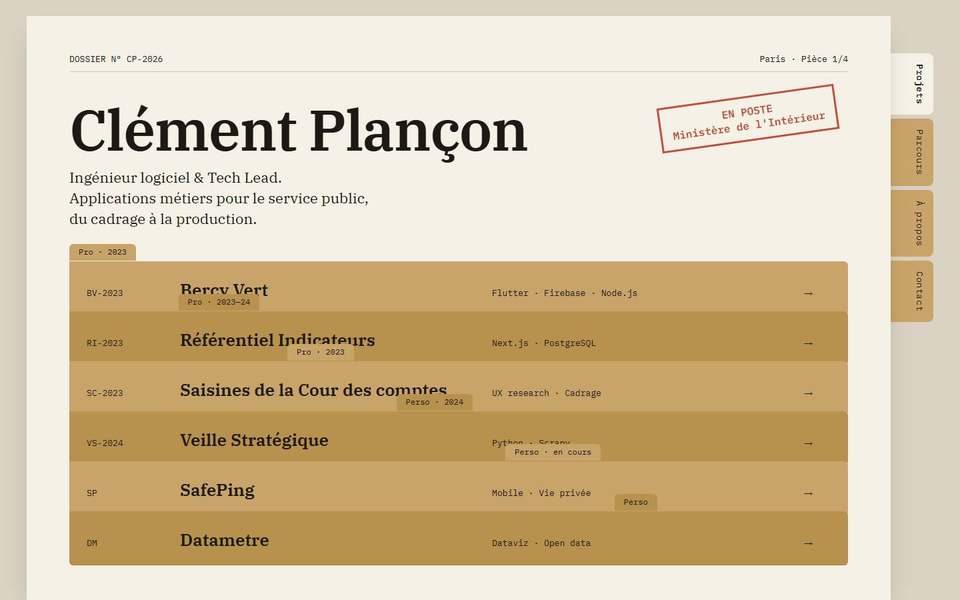
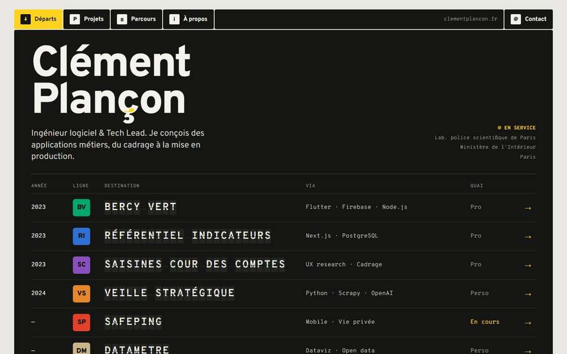
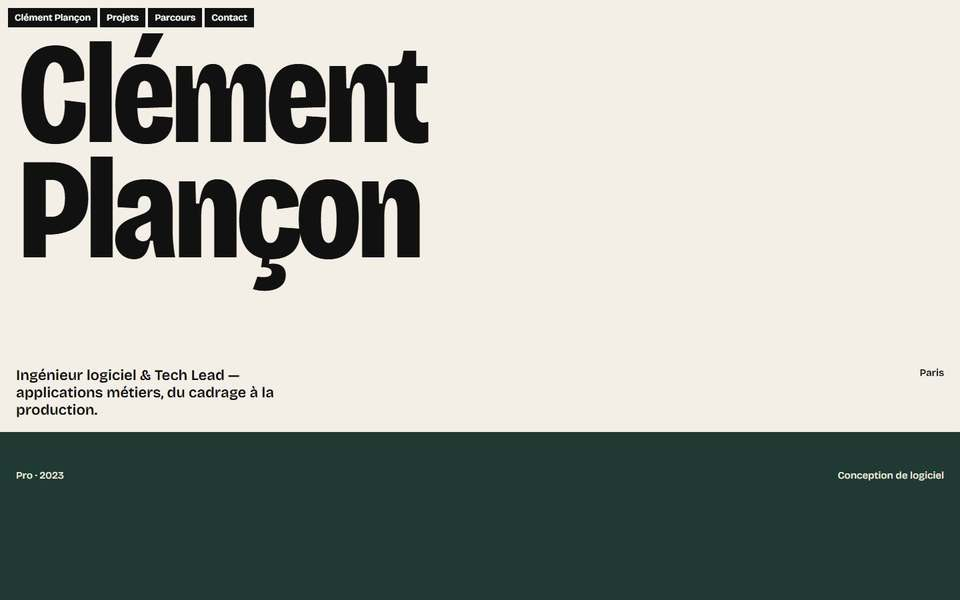

# Direction artistique

## Le problème de la version précédente

Propre, lisible, techniquement juste — et interchangeable. Papier crème, grande grotesque, accent vermillon, liste de projets avec visionneuse : chacun de ces choix était défendable, l'ensemble n'appartenait à personne. La seule signature (la cédille colorée) était un détail, pas un système.

## Trois directions explorées

Les trois ont été prototypées en HTML avec le vrai contenu, puis capturées en 1440 et 390 px (`docs/prototypes/`).

### A — « Dossier »
L'archive administrative : feuille de papier, chemises kraft empilées dont les onglets portent la catégorie et l'année, intercalaires verticaux en guise de navigation, tampon « En poste », IBM Plex Mono et Serif.
- **Interaction signature** : tirer une chemise hors de la pile (la chemise survolée remonte, la page projet s'ouvre comme un dossier).
- **Mobile** : les intercalaires deviennent une rangée d'onglets en bas d'écran.

### B — « Départs »
La signalétique d'information voyageurs : panneaux noirs assemblés bord à bord, jaune signal, pictogrammes, indices de ligne colorés, tableau d'affichage à palettes. Overpass (dérivée de la Highway Gothic des panneaux routiers) et Overpass Mono.
- **Interaction signature** : les noms de projets s'affichent sur un tableau à palettes ; l'indice de ligne du projet devient l'en-tête de sa page.
- **Mobile** : le tableau devient une colonne de lignes ; la navigation est un panneau en bas d'écran.

### C — « Spécimen »
La fonderie typographique : bandes de couleur pleine largeur, chaque projet composé dans une instance extrême de la police variable (graisse, chasse, italique).
- **Interaction signature** : les axes de la police réagissent au défilement ; une bande s'ouvre en page projet.
- **Mobile** : les bandes s'empilent naturellement.

## Comparaison

Notes de 1 à 5, attribuées après revue des captures et manipulation des prototypes.

| Critère | A Dossier | B Départs | C Spécimen |
|---|---|---|---|
| Originalité | 4 | 4 | 2 — proche de Commercial Type |
| Personnalité (lien avec le parcours) | 4 — administration | 5 — service public, information, fiabilité | 2 — pas un typographe |
| Mémorisation | 4 | 5 | 3 |
| Cohérence du système | 3 — le kraft s'épuise vite | 5 — panneaux, indices, pictogrammes, palettes | 4 |
| Ergonomie | 3 — onglets verticaux, chevauchements | 5 — un panneau = un message ; projets visibles au premier écran | 2 — un écran par projet, gros titres |
| Performance | 5 | 4 — palettes à surveiller | 5 |
| Accessibilité | 4 | 5 — contraste noir / jaune / blanc maximal | 3 — couleurs de bandes variables |
| Mobile | 3 | 5 | 4 |

**Choix : B, « Départs ».**

Pourquoi :
- La signalétique est la discipline de design dont le seul but est que personne ne se perde. C'est l'exigence UX de ce portfolio.
- Elle parle du métier sans le caricaturer : de l'information claire pour le service public, des systèmes qui doivent fonctionner à l'heure.
- Elle est très rare dans les portfolios de développeurs, et elle n'a besoin ni de 3D ni d'images inventées.
- Le premier écran est fonctionnel : nom, rôle, poste actuel et les six projets, sans défiler sur desktop.

Ce que je n'ai **pas** repris de A et C : le papier kraft, le tampon, les bandes pleine page et le gros nom seul. Mélanger les trois aurait dilué le système.

## Garde-fous contre le pastiche

- **Pas d'imagerie ferroviaire** : ni train, ni logo de transporteur, ni bruit de quai. On emprunte la *grammaire* de la signalétique, pas son décor.
- **Vocabulaire clair** : les libellés restent « Projets », « Parcours », « Contact ». Le panneau dit « Projets », pas « Départs ». Seuls deux clins d'œil, compris sans explication : « En service » pour le poste actuel et la flèche de sortie vers le contact.
- **Majuscules à chasse fixe** seulement sur le tableau (titres de projets, courts). Tout le reste en minuscules lisibles.
- **Animation** réservée au tableau et aux transitions vers les pages projet ; le reste du site est immobile.

## Système

### Composition : l'assemblage de panneaux
Tout est construit en **panneaux rectangulaires assemblés bord à bord avec un joint de 2 px**, comme un totem de signalétique. La navigation est une rangée de panneaux ; une page est une pile de panneaux ; le tableau des projets est un grand panneau. Il n'y a pas de cartes flottantes, pas d'ombres, pas de flou. C'est la règle qui rend le site reconnaissable sans logo.

### Couleurs
| Rôle | Valeur | Usage |
|---|---|---|
| Fond (béton clair) | `#e7e5df` | arrière-plan des pages |
| Panneau | `#141513` | navigation, tableau, en-têtes |
| Panneau secondaire | `#20221e` | cases des palettes, survols |
| Texte sur panneau | `#f4f2ec` | |
| Texte secondaire sur panneau | `#a6a59d` | ≥ 7:1 sur panneau |
| Jaune signal | `#ffd21f` | « vous êtes ici », état actif, flèches, contact |
| Encre | `#121310` | texte sur fond clair et sur jaune |
| Panneau clair | `#f4f2ec` | blocs d'information sur fond clair |

Couleurs de ligne (une par projet, choisie dans l'administration) : vert, bleu, violet, orange, rouge, sable. Elles ne servent qu'aux **indices de ligne** et aux en-têtes de projet, avec un texte noir ou blanc selon le contraste.

### Typographie
- **Overpass** (variable 100–900) : dessinée d'après la Highway Gothic des panneaux routiers américains. Titres en 800, texte en 400.
- **Overpass Mono** : tableau à palettes, années, métadonnées, technologies.
- Corps de texte 17–18 px, interlignage 1,55. Pas de titre plus grand que nécessaire : le nom fait 4 à 6 rem, pas 15.

### Signes
- **Indice de ligne** : carré coloré à coins légèrement arrondis portant deux lettres (BV, RI, SC, VS, SP, DM), modifiable dans l'administration.
- **Pictogrammes** : un par projet, tracé 2 px sur une grille 24, même style que les pictogrammes de navigation. C'est une interprétation graphique assumée, pas une capture.
- **Flèche** : seule marque d'action. Une flèche jaune = on peut y aller.
- **Vous êtes ici** : le panneau de navigation de la page courante passe en jaune.

### Traitement des projets
- **Accueil et index** : le tableau. Une ligne par projet : année, indice, nom sur palettes, technologies, type, flèche. Au survol ou au focus, la bande d'information du bas affiche le résumé du projet.
- **Page projet** : un en-tête panneau dans la couleur de ligne, avec l'indice en grand, le pictogramme et les métadonnées. Vient ensuite un **plan de ligne** : les sections de la page sont les arrêts, et l'arrêt courant est marqué « vous êtes ici » pendant la lecture. La capture réelle (Datametre) est encadrée comme un écran d'information.
- **Projets professionnels / personnels** : même système. Le type est affiché en clair dans une colonne dédiée ; les projets en cours portent l'état « En cours » en jaune.

### Mobile
- Navigation : panneau fixe en bas (4 pictogrammes + libellés), à portée de pouce, avec « vous êtes ici » en jaune.
- Tableau : chaque ligne devient un bloc indice + nom + année + technologies + résumé court. Pas de survol nécessaire.
- Plan de ligne d'un projet : il devient une rangée d'arrêts défilable horizontalement, collée sous l'en-tête.

## Contrôle final (questions du cahier des charges)

| Question | Réponse | Ce qui le justifie / ce qui manque |
|---|---|---|
| Reconnaissable immédiatement ? | Oui | Panneaux noirs assemblés, jaune signal, tableau à palettes : aucun autre portfolio de développeur étudié n'utilise ce système. |
| Identité visuelle forte ? | Oui | Une grammaire complète (panneau, joint, indice, pictogramme, flèche, « vous êtes ici »), appliquée à toutes les pages et à l'image de partage. |
| Mémorable sans être spectaculaire ? | Oui | Une seule animation (le tableau), une seule transition (l'indice qui voyage). Pas de 3D, pas d'écran d'entrée. |
| Les interactions améliorent-elles l'expérience ? | Oui | Bande d'information = résumé sans encombrer ; plan de ligne = navigation dans la page ; « vous êtes ici » = orientation. |
| Les projets donnent-ils envie d'être explorés ? | Plutôt oui | Chaque projet a sa couleur, son indice et son pictogramme. Limite : sans captures réelles (5 projets sur 6), les pages projet reposent sur l'interprétation graphique ; ajouter des captures dans l'administration les enrichira. |
| Mobile aussi qualitatif que desktop ? | Oui | Barre de signalisation en bas, tableau repensé en blocs avec résumé, plan de ligne horizontal ; testé de 320 à 430 px et en paysage. |
| Véritable travail de direction artistique ? | Oui | Trois directions prototypées et comparées, choix argumenté, garde-fous contre le pastiche. |
| Visuellement cohérent ? | Oui | Mêmes tokens et mêmes composants partout, administration comprise. |
| Fluide sur matériel ordinaire ? | Oui | Lighthouse mobile 100, 2,9 Ko de JavaScript, animation désactivée sur appareils modestes. |
| Un autre développeur voudrait-il s'en inspirer ? | À confirmer | C'est l'objectif ; seul un retour de vrais visiteurs le dira. |
