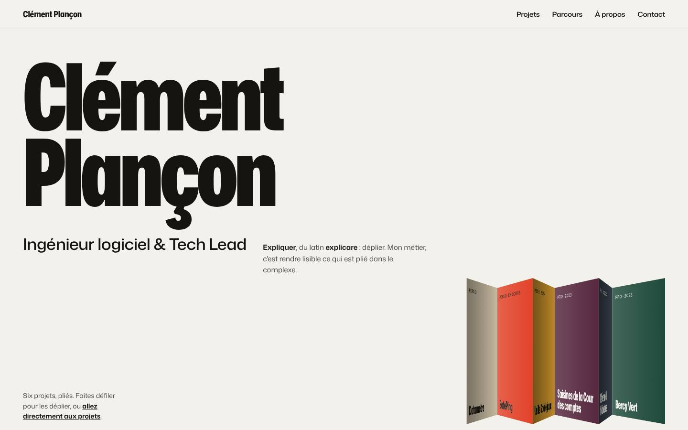
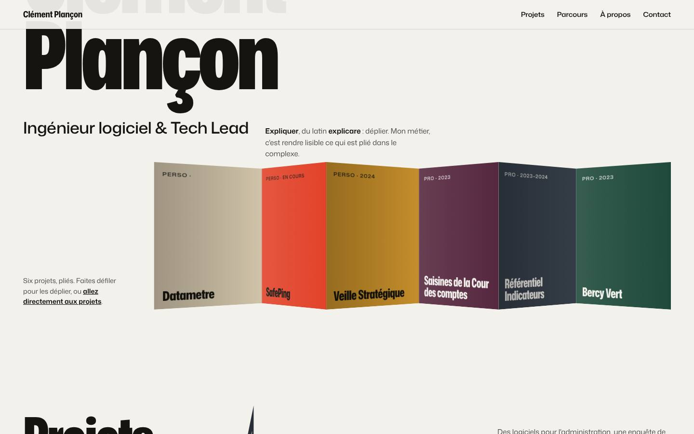
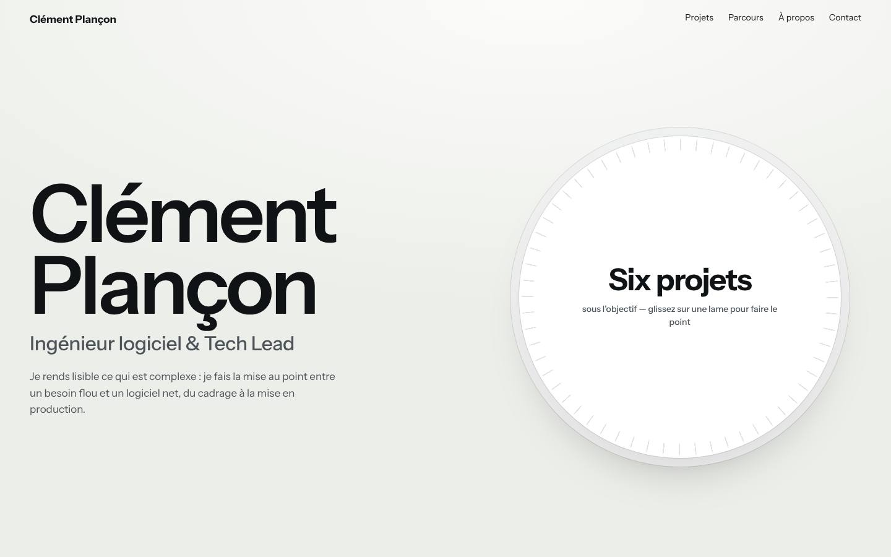
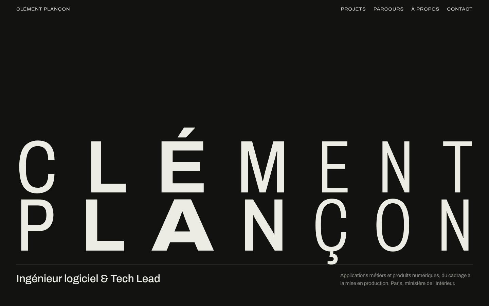

# Direction artistique : « Expliquer »

## Le point de départ

Le site devient **une seule page**. Il garde le contenu réel, l'administration et l'infrastructure, mais change entièrement de langage visuel. La direction précédente (« Révélateur », cyanotypes) est abandonnée. Ses photogrammes illustraient des projets qui n'en avaient pas besoin, et elle reposait sur des pages séparées.

Contraintes du brief retenues comme critères :

- **Signature et clarté** : une signature forte, mais le nom et le rôle lisibles immédiatement, sans introduction bloquante.
- **Projets** : des projets réels mis en scène, détail consultable sans changer de page, retour facile à la liste.
- **Proscrit** : aucune image, métrique ou capture inventée ; aucun cliché « IA » (dégradés lumineux, badges, faux terminaux, numérotation 01/02/03, trois cartes identiques, *fade-up* systématique).
- **Mouvement et mobile** : un mouvement qui fait partie de l'identité, qui respecte `prefers-reduced-motion` et ne bloque pas le défilement ; un mobile pensé pour le doigt.

## Trois concepts prototypés

Chaque prototype est une page HTML autonome qui utilise le vrai contenu. `data.js` est généré depuis `src/content`. Les prototypes sont dans `docs/prototypes/v3/` et ont tous été capturés dans Chromium en 1440 et 390 px.

### A — « Expliquer » (retenu)

*Expliquer* vient du latin *explicare*, « déplier ». Le site est **une feuille pliée qu'on déplie** : la couverture porte une bande de projets en accordéon qui s'ouvre avec le défilement. Les projets forment une carte de volets de papier de couleur, et chaque volet déplie son détail sous sa rangée. Le parcours est un triptyque, le contact une carte de visite pliée en deux.

### B — « Mise au point »

Les projets sont des lames sous un objectif circulaire : on glisse sur une lame pour faire le point (flou → net).

### C — « Variable »

La typographie variable porte toute l'identité : le nom change de largeur et de graisse lettre par lettre avec le défilement et le pointeur. Les projets forment une liste typographique.

## Évaluation

Notes de 1 à 5, après manipulation des trois prototypes et revue des captures desktop et mobile.

| Critère | A Expliquer | B Mise au point | C Variable |
|---|---|---|---|
| Idée propre au profil | 5 — le mot « expliquer » *est* le geste | 4 — rendre net, juste mais attendu | 2 — identité de type, pas de personne |
| Originalité | 5 — aucune des références étudiées ne plie la page | 3 — le cercle et le flou sont des motifs vus | 2 — genre très présent sur Awwwards |
| Projets protagonistes | 5 — volets de couleur, détail sur place | 3 — texte dans un cercle, peu lisible | 2 — une liste sans image |
| Honnêteté des visuels | 5 — papier de couleur ; la seule vraie capture (Datametre) y trouve sa place | 4 | 4 |
| Mobile | 5 — l'accordéon devient vertical, aussi fort qu'en desktop | 2 — le cercle rétrécit, le glisser entre en conflit avec le défilement | 4 |
| Lisibilité | 4 — à surveiller : textes sur papiers de couleur | 3 | 3 — lettres déformées |
| Faisabilité, performance | 4 — CSS 3D pur, aucun WebGL | 4 | 5 |

**A est retenu.** C'est le seul concept dont l'idée vient du métier même de Clément Plançon (« Je rends lisible ce qui est complexe ») et passe dans chaque interaction, sans décor ajouté. B a été jugé trop proche d'un gabarit, et son texte inscrit dans un cercle se lit mal. C relève d'un genre courant et laisse les projets sans image.

## Le système

### Matière

| Rôle | Clair | Sombre |
|---|---|---|
| Papier (fond) | `#f3f1ec` | `#141412` |
| Feuille (surfaces dépliées) | `#fbfaf7` | `#1f1e1b` |
| Encre | `#15140f` | `#ebe8e0` |
| Encre secondaire | `#4a4842` | `#aaa79d` |
| Signal (un seul accent) | `#e8553a` | `#e8553a` |

Le thème sombre suit `prefers-color-scheme` : le papier devient noir, les papiers des projets restent les mêmes.

**Papiers des projets** (`src/lib/stocks.ts`) : vermillon, vert sapin, ardoise, ocre, prune, sable. Chaque papier a son encre, et un test unitaire vérifie un contraste d'au moins 4,5:1. Le papier tient lieu d'image du projet. Une vraie capture, s'il en existe une, s'imprime sur le volet. Aucune interface simulée n'est fabriquée.

### Typographie

Une seule famille, **Mona Sans** variable, en deux voix :

- `.display` : largeur 75 %, graisse 840, interlignage 0,86. Sert au nom, aux titres de section et aux titres de volets : une voix condensée et dense, comme imprimée.
- `.label` : largeur 125 %, capitales espacées à 0,75 rem. Sert aux métadonnées, catégories et périodes.
- Le texte courant reste en largeur normale.

La largeur variable remplace une seconde police et garde une seule requête de police (87 Ko).

### Plis

Tout ce qui entre à l'écran se **déplie**, aucun élément n'apparaît en fondu vers le haut. Chaque pli a une direction propre à son élément : les volets de la première colonne basculent sur l'axe horizontal, les suivants pivotent comme des pages, les panneaux latéraux du triptyque s'ouvrent comme des portes, et la carte de contact se retourne. L'ombre d'un pli est calculée à partir de son angle (`sin()`), donc elle disparaît quand la feuille est à plat.

### Composition

- **Couverture** : le nom en très grand (adapté à la hauteur de l'écran), le rôle, la phrase « *Expliquer*, du latin *explicare* : déplier. », puis le poste actuel et le poste en parallèle. Dessous, la bande des projets étoilés.
- **À propos** : introduction, biographie, devise en grand, principes en accordéon.
- **Projets** : carte de 3 × 2 volets (2 colonnes en tablette, 1 en mobile), le détail se déplie sous la rangée.
- **Parcours** : triptyque, avec le poste principal au centre.
- **Compétences** : le « dos du dépliant », une grille de groupes sans jauge ni pourcentage.
- **Contact** : le dépliant se referme sur une carte de visite.

## Ce qui a été écarté exprès

- Toute numérotation de section ou de projet.
- Les jauges de compétences et les métriques inventées.
- Les logos d'organisations.
- Une frise chronologique.
- Le bloc jaune de contact de l'ancienne version.
- Le WebGL : le pli se fait en CSS 3D, donc il est indexable, accessible et léger.
- Le défilement détourné (*scroll-jacking*) : le défilement reste natif, seule la bande de couverture suit sa position.
